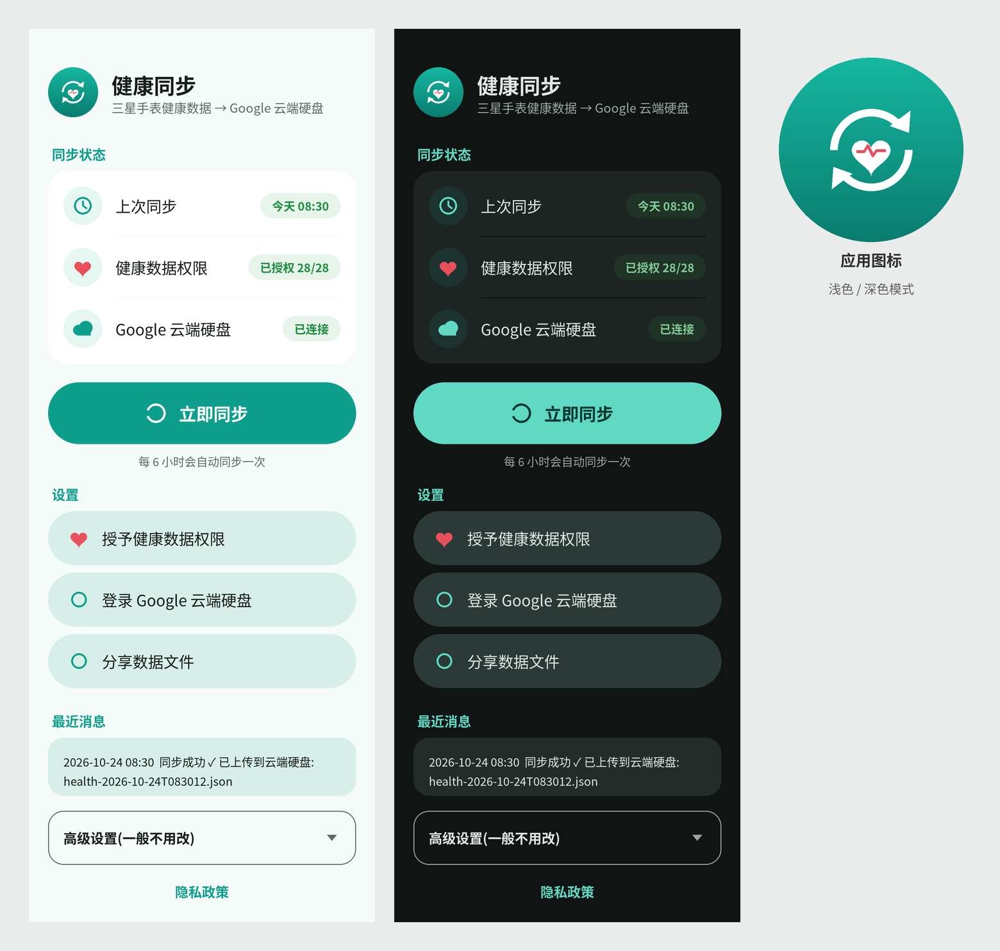

# 三星健康接入AI

「健康同步」是一个安卓应用：把**三星健康**（Samsung Health，包括三星手表）里的健康数据读出来，整理成 JSON 文件，自动上传到**你自己的 Google 云端硬盘**里的 `HealthSync` 文件夹。之后你可以把这些文件交给 AI（比如 ChatGPT、Gemini 等）帮你分析睡眠、心率、运动等情况。

- 支持步数、睡眠、心率、血氧、血压、体成分、体温、运动、饮水、营养、血糖等
- 每 6 小时自动同步一次，也可以手动点「立即同步」
- 三星健康不可用时，会尝试通过 Health Connect 读取（备用）

## 使用要求

- 安卓 10 或更高版本
- 三星健康 6.30.2 或更高版本
- 一个 Google 账号
- **中国大陆用户**：登录 Google 和上传云端硬盘需要能访问 Google 的网络

## 安装

目前暂不提供现成的安装包（正在向三星申请正式合作，通过后会在 Releases 中发布）。现在想使用，请按下方「开发者：自己编译」的步骤自己打包，然后安装到手机上。

## 第一次使用前：打开三星健康开发者模式（必须）

1. 打开**三星健康** → 右上角菜单 → **设置**
2. 点 **关于三星健康**
3. **连续点击版本号**多次，直到出现开发者模式选项
4. 打开 **Developer mode (Samsung Health Data SDK)**

## 开始同步

1. 打开「健康同步」应用
2. 点 **登录 Google 云端硬盘**，选择你的 Google 账号并允许
3. 点 **授予三星健康权限**，在弹出页面中全部允许
4. 点 **立即同步**。成功后，在你的 Google 云端硬盘里会出现 `HealthSync` 文件夹

如果提示无法获取三星健康权限，请再检查一遍上面的"开发者模式"。

## 隐私

数据只保存在你的手机和**你自己的** Google 云端硬盘中。没有开发者服务器，不会分享给任何第三方。详见 [PRIVACY.md](PRIVACY.md)。

## 问题反馈

请在 [Issues](https://github.com/weicao503-design/samsung-health-ai/issues) 中提出，或发邮件到 weicao503@gmail.com。

## 开发者：自己编译

需要 JDK 17 和 Android SDK。

1. 三星健康 SDK 不在本仓库中（三星的许可不允许转发）。请到 <https://developer.samsung.com/health/data/overview.html> 下载 **Samsung Health Data SDK**（1.1.0），把其中的 `samsung-health-data-api-1.1.0.aar` 放到 `app/libs/`，或运行：
   `./build-with-samsung-sdk.sh 下载的SDK.zip`
   （没有 aar 也能编译，但只会使用 Health Connect 备用方式。）
2. 签名：在 `keystore/keystore.properties` 中填写 `storeFile`、`storePassword`、`keyAlias`、`keyPassword`（不要提交到 Git）。没有该文件时，release 包不签名。
3. `./gradlew assembleRelease`
4. Google 登录要求在你自己的 Google Cloud 项目中创建 "Android" 类型 OAuth 客户端，绑定包名和你的签名 SHA-1，并启用 Google Drive API。如果使用自己的签名，请同时修改 `applicationId`。

---

## English summary

**Samsung Health → AI**: an Android app (Android 10+, Samsung Health 6.30.2+) that reads your Samsung Health data via the Samsung Health Data SDK (Health Connect as fallback) and uploads JSON files to a `HealthSync` folder in *your own* Google Drive (drive.file scope), so you can analyze them with AI. No developer server, no third-party sharing. A ready-made APK will be published in Releases after Samsung partnership approval; for now build it yourself. Before first use, enable *Samsung Health → Settings → About Samsung Health → tap version repeatedly → Developer mode (Samsung Health Data SDK)*. The Samsung SDK .aar is not redistributed; download it from developer.samsung.com into `app/libs/` to build. Feedback: [Issues](https://github.com/weicao503-design/samsung-health-ai/issues).
